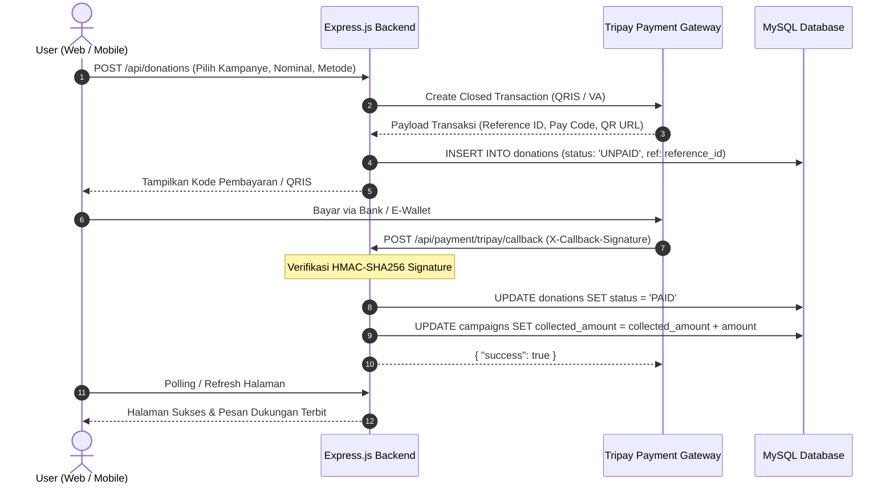

# Panduan Deployment & Operasi Production (Donaria / Reputasi)

Dokumen ini menjelaskan prosedur deployment, konfigurasi environment, dan langkah pengerasan keamanan (*security hardening*) untuk platform donasi **Donaria** (nama kode repositori: `Reputasi`).

---

## 📋 1. Konfigurasi Environment (`.env`)

Salin file `.env.example` ke `.env` pada folder `backend/`:

```bash
cd backend
cp .env.example .env
```

Isi variabel environment produksi berikut:

```ini
# Server Configuration
NODE_ENV=production
PORT=3000
APP_URL=https://donaria.id

# Database MySQL Production
DB_HOST=127.0.0.1
DB_PORT=3306
DB_USER=donaria_prod
DB_PASS=S4ngatR4hasia_MySQL_2026!
DB_NAME=donaria_production

# JWT Authentication Secret
# Generate dengan: openssl rand -base64 64
JWT_SECRET=super_secret_jwt_random_hash_key_donaria_prod_2026
JWT_EXPIRES_IN=7d

# Tripay Payment Gateway (Production Mode)
TRIPAY_API_KEY=DEV-xxxx-xxxx-xxxx
TRIPAY_PRIVATE_KEY=xxxx-xxxx-xxxx-xxxx
TRIPAY_MERCHANT_CODE=T12345
TRIPAY_API_URL=https://tripay.co.id/api/
TRIPAY_CALLBACK_URL=https://api.donaria.id/api/payment/tripay/callback
TRIPAY_IS_PRODUCTION=true

# Security & CORS
ALLOWED_ORIGINS=https://donaria.id,https://admin.donaria.id
RATE_LIMIT_WINDOW_MS=900000
RATE_LIMIT_MAX=100
```

---

## 🔒 2. Langkah Pengerasan Keamanan (Security Hardening)

### A. Rate Limiting
- Terapkan `express-rate-limit` pada endpoint publik (`/api/donations/create` dan `/api/auth/login`) maksimal 5-10 request per menit per IP untuk mencegah *brute-force* atau serangan bot pembuatan invoice palsu.
- Pastikan reverse proxy (Nginx) meneruskan header `X-Forwarded-For` dan mengaktifkan `app.set('trust proxy', 1)`.

### B. Proteksi CORS (Cross-Origin Resource Sharing)
- Jangan pernah menggunakan `cors({ origin: '*' })` pada lingkungan produksi.
- Kunci `origin` secara eksplisit hanya untuk domain website donasi dan dashboard admin resmi.

### C. Validasi Callback Tripay (Signature Verification)
- Setiap notifikasi webhook dari Tripay WAJIB divalidasi keasliannya menggunakan HMAC-SHA256:
  ```javascript
  const signature = crypto
    .createHmac('sha256', process.env.TRIPAY_PRIVATE_KEY)
    .update(rawBody)
    .digest('hex');
  if (req.headers['x-callback-signature'] !== signature) {
    return res.status(400).json({ error: 'Invalid callback signature' });
  }
  ```
- Blokir pembaruan status transaksi jika tanda tangan digital tidak cocok.

### D. Backup Database Otomatis
Buat cron job terjadwal untuk melakukan *daily mysqldump* terenkripsi:

```bash
# Simpan di /etc/cron.daily/backup-donaria
mysqldump -u donaria_prod -p'S4ngatR4hasia_MySQL_2026!' donaria_production | gzip > /var/backups/donaria_$(date +\%Y\%m\%d).sql.gz
find /var/backups/ -name "donaria_*.sql.gz" -mtime +14 -delete
```

---

## 🔄 3. Diagram Alur Transaksi Donasi (Sequence Diagram)



---

## 🚀 4. Manajemen Proses Produksi via PM2

Gunakan PM2 untuk menjaga layanan tetap hidup (*auto-restart* & *clustering*):

```bash
npm install -g pm2
cd backend
pm2 start server.js --name "donaria-api" -i max
pm2 save
pm2 startup
```
